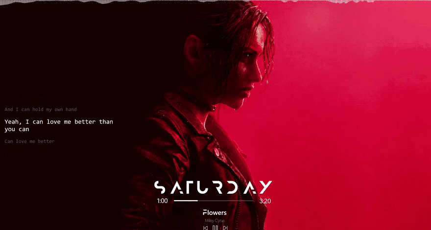

<p align="center"></p>

<h1 align="center">Inlay</h1>

<p align="center"><b>Live widgets, set into your Windows desktop.</b></p>

<p align="center">A clock, a visualizer, synced lyrics and a player, drawn behind your desktop icons by one small native app. A light alternative to Rainmeter.</p>

<p align="center">
  <a href="https://github.com/akshit-bansal11/deskbeat/releases/latest"><b>Download</b></a> ·
  <a href="https://deskbeat.akshitbansal.dev">Website</a> ·
  <a href="https://deskbeat.akshitbansal.dev/docs">Documentation</a>
</p>

<p align="center"></p>

[](https://github.com/akshit-bansal11/deskbeat/actions/workflows/ci.yml)
[](https://github.com/akshit-bansal11/deskbeat/releases/latest)
[](LICENSE)

> **Inlay was called Deskbeat**, and before that Sonic Veil. Your settings, fonts and start-with-Windows switch carry over the first time `Inlay-<version>.exe` runs.

## What it is

Inlay sets four live widgets into the desktop, on the wallpaper layer and behind the icons. They aren't windows you manage. They're part of the desktop.

| Widget | What it shows |
| --- | --- |
| **Clock** | Day, time and date, each placed and styled on its own. Works with nothing else running. |
| **Visualizer** | A spectrum of Spotify's audio alone, not your games or calls. Bars, mirrored bars or a wave. |
| **Lyrics** | Time-synced lyrics. Where the song has timed words, they light up or fill word by word as they're sung; elsewhere, line by line. |
| **Player** | Album art, title, artist, a progress bar you can click to seek, and previous, play/pause and next. |

The visualizer, lyrics and player follow whatever Spotify plays. There's no Spotify login and no client ID: the track and the controls come from Windows itself, so a free account works.

## Why it stays light

A widget is redrawn only when something on it changes. Nothing is drawn while it sits still.

- **One native process.** Rust and Direct2D, with no webview, no runtime and no skin interpreter.
- **Event-driven.** The clock wakes once a minute, lyrics at the next line, the player once a second. The visualizer runs only while there's sound.
- **Nothing hidden is drawn.** A widget under a maximized or fullscreen window stops entirely.
- **The low-power GPU.** On a laptop with two GPUs, it uses the integrated one.

Memory use measured about 54 MB, above the 40 MB this was aiming for.

## Install

1. Download `Inlay-<version>.exe` from [Releases](https://github.com/akshit-bansal11/deskbeat/releases/latest). There is no installer.
2. Run it. The exe is unsigned, so the first time SmartScreen warns: choose **More info**, then **Run anyway**.

It needs Windows 11. The music widgets need the Spotify desktop app playing on the same PC; playback sent to another device through Spotify Connect isn't seen.

## Use

Inlay lives in the notification area. **Double-click** its icon for settings. **Right-click** it for a small menu: the version, a link to this repository, the start-with-Windows switch and Quit.

| Hotkey | Does |
| --- | --- |
| `Ctrl+Alt+S` | Open settings |
| `Ctrl+Alt+E` | Edit layout: drag any element of the clock or player on its own, or drag the lyrics or visualizer |
| `Ctrl+Alt+H` | Hide or show every widget |
| `Ctrl+Alt+Up` / `Down` | Show lyrics 100 ms earlier / later |

Hotkeys can be turned off in settings.

### Edit layout

The clock and the player have no box. Each of their elements (the day, time and date, and the player's art, title, artist, each button, the bar and both times) can be dragged anywhere on its own. The one under the pointer is outlined, and nothing else is drawn. Shift+click selects several, which then move together. The Player tab has two ready-made arrangements to start from.

### Settings

The settings panel has a page for each widget, split into its parts. Every part has its own position, in the display's own pixels, on sliders notched at every quarter of the screen.

- **Text:** every piece of text has its own font, size, weight, colour, opacity, letter spacing and capitals. It can run across, down or up, with its letters upright or lying sideways, so the day can stand as a column or turn on its side like the spine of a book.
- **Visualizer:** bar width and gap stay fixed whatever the number of bars; bars that don't fit are left out. It can turn a quarter to run down the side of the screen.
- **Player:** the bar's length, thickness and colour, the buttons' size and colour, and the art's size and corner rounding. Titles show the song's name alone, without the version, credits or film Spotify appends, and are never cut short.
- **Colour:** every colour setting has a picker, with a colour square, a hue bar and a hex field.
- **Layer:** widgets can sit on the desktop under your windows (the default), behave like a normal window, or stay on top of everything.

### The config file

Everything is stored in one file. You can edit it by hand, and it reloads when you save:

```
%APPDATA%\inlay\config.toml
```

The file accepts two things the panel doesn't: any installed font, and a hand-written clock format (`%H:%M`, `%l:%M %p`, `%A, %e %B` and so on).

To use a font without installing it, put its `.ttf` or `.otf` file in `%APPDATA%\inlay\fonts` and restart Inlay. The clock's day and time default to Anurati and Quicksand, the pairing of the Mond Rainmeter skin. They aren't shipped with the app, so the theme font is used until they're in that folder.

## Troubleshooting

Inlay has no console, so its diagnostics write to a file. In a terminal, with Spotify playing:

```
Inlay-<version>.exe --probe > probe.txt
```

That records, for eight seconds, what Windows reports about the track and how loud Spotify's audio is. Two more:

- `--probe-system` listens to everything the PC plays, not Spotify alone.
- `--probe-lyrics "Title" "Artist"` looks one track up, for word timing and on LRCLIB.

Errors go to `%LOCALAPPDATA%\inlay\inlay.log`. The lyrics cache is in the same folder and is safe to delete.

Word timing depends on community-run LyricsPlus servers. When none answers, lyrics fall back to line timing from LRCLIB.

## What goes over the network

Only lyrics lookups. For each new track, its title, artist, album and length go over HTTPS to [LRCLIB](https://lrclib.net) and, when word timing is on, to the LyricsPlus servers listed in the config. Nothing else is sent: no identifier, no listening history, no audio. Turning the lyrics widget off stops both. [SECURITY.md](SECURITY.md) has the full model.

## What has and hasn't been tested

On a real Windows 11 desktop:

- All four widgets draw, sit on the desktop layer, and cost no CPU while idle.
- Lyrics lookup, title cleaning and the disk cache against LRCLIB, and word timing from a LyricsPlus server.
- Audio capture, for one app and for the whole system.
- Reading the track, position and album art from a running Spotify.
- An older config file loading with its sizes and fonts intact.

Only by automated tests and rendered snapshots:

- The settings panel, the colour picker, and dragging and multi-selecting in edit layout.
- The word-by-word fill staying in time with a song.
- The transport buttons and seeking.
- Staying visible through Show Desktop (`Win+D`).
- Settings carrying over from the Deskbeat and Sonic Veil names.

## Build from source

You need Windows 11, stable Rust 1.89 or later with `rustfmt`, `clippy` and the MSVC build tools, and PowerShell 7 (`pwsh`).

```powershell
git clone https://github.com/akshit-bansal11/deskbeat.git inlay
cd inlay
cargo run --release                             # the tray app; quit any other copy first
cargo run --release -- --snapshot snapshots     # every widget and the settings panel, to PNG
pwsh scripts/check.ps1                          # format, clippy with warnings as errors, tests
```

Only one copy runs at a time: a second launch hands over to the first and exits. `--snapshot` draws from made-up data with no GPU or Spotify, and it's how CI checks the drawing code.

| Path | What |
| --- | --- |
| `crates/core` | Pure logic with no Windows types: lyric parsing and timing, the sync clock, band mapping, colour, the config schema, the logo's geometry. Its tests run anywhere. |
| `crates/app` | The exe: windows, Direct2D drawing, the media session, audio capture, the settings panel, the tray. |
| `scripts/` | The quality gate and the script that writes the exe's icon. |
| `docs/` | [How it works](docs/ARCHITECTURE.md). |
| `packaging/` | The winget manifests. |
| `site/` | The [website](site/README.md), with its own checks and workflow. |

## Contributing

- **A bug or an idea:** [open an issue](https://github.com/akshit-bansal11/deskbeat/issues/new/choose). Open one before starting anything bigger than a fix.
- **A security hole:** report it privately, as [SECURITY.md](SECURITY.md) describes.
- **A change:** branch from your fork, run the gate until it's clean, and open a pull request against `main`. [CONTRIBUTING.md](CONTRIBUTING.md) has the details.

[CHANGELOG.md](CHANGELOG.md) lists what each release changed.

## Support

Inlay is free and stays free. If it's useful to you and you'd like to say so with money:

- **[Ko-fi](https://ko-fi.com/akshit_bansal11)**, from anywhere.
- **[PayPal](https://paypal.me/AkshitBansal141)**, from anywhere.
- **UPI**, from any UPI app in India: `artistbansal2004@okaxis`

A star, a bug report or telling someone about it helps just as much.

## License and credits

[MIT](LICENSE).

- Line-timed lyrics come from [LRCLIB](https://lrclib.net). Word-timed lyrics come from community-run LyricsPlus servers.
- Built on [windows-rs](https://github.com/microsoft/windows-rs), [RustFFT](https://github.com/ejmahler/RustFFT), [serde](https://serde.rs) and [toml](https://github.com/toml-rs/toml), all MIT or Apache 2.0.
- The clock's default pairing, Anurati and Quicksand, follows the Mond Rainmeter skin. Neither font is distributed with Inlay.
- Spotify is a trademark of Spotify AB. Inlay isn't affiliated with or endorsed by Spotify; it reads what Windows reports about the app that's playing.
